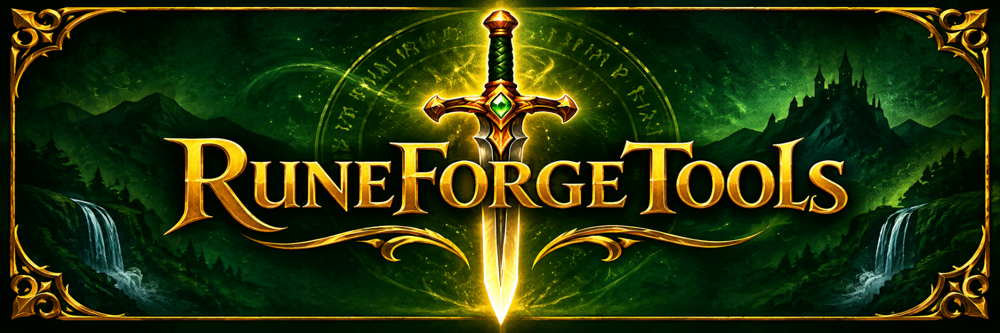

# RuneForgeTools ⚔️

**Free games, gaming utilities, and creative software.**

Welcome to RuneForgeTools! I build games and practical utilities for gaming and creative projects. Explore my projects below.

## 🎮 Featured project: Zelda Save Manager

**Version:** v0.1.0 Beta · **Platform:** Windows · **Status:** Public beta

Zelda Save Manager is a fan-made utility for *The Legend of Zelda: Ocarina of Time* and the Longshot randomizer.

### Highlights
- Manage multiple player profiles, saves, and settings
- Track items, equipment upgrades, and randomizer progression
- Use a two-stage hint system for general areas and specific checks
- Review progression guidance as you update collected items
- Enjoy a Zelda-inspired interface

**[⬇️ Download the Windows beta](https://github.com/RuneForgeTools/ZeldaSaveManager-Releases/releases/download/v0.1.0-beta.1/ZeldaSaveManager_v0.1.0-beta.1_Windows.zip)**

[Release notes](https://github.com/RuneForgeTools/ZeldaSaveManager-Releases/releases/tag/v0.1.0-beta.1) · [Project page](https://github.com/RuneForgeTools/ZeldaSaveManager-Releases) · [Report a bug or suggest a feature](https://github.com/RuneForgeTools/ZeldaSaveManager-Releases/issues)

> **Beta software:** Features and compatibility may change. Please report issues so future releases can improve.

## 🐾 Red Panda Den

**Platform:** Web browser · **Type:** Cooperative survival card game

Red Panda Den is a browser-based cooperative survival card game. Play directly in your browser—no Windows download required.

**[🐼 Play Red Panda Den](https://red-panda-den-joel.peachybread65.chatgpt.site/)**

## 🛠️ What's next?

I'm continuing to develop Zelda Save Manager and Red Panda Den, alongside ideas for future games and creative utilities. Follow this profile or watch the releases repository for updates.

## ☕ Support development

These tools are free to use. If you'd like to support continued development, visit **[RuneForgeTools on Ko-fi](https://ko-fi.com/runeforgetools)**.

---

*RuneForgeTools is an independent developer project. Zelda Save Manager is not affiliated with, sponsored by, or endorsed by Nintendo or the Longshot development team. No game ROMs or Longshot executables are included in the download.*
